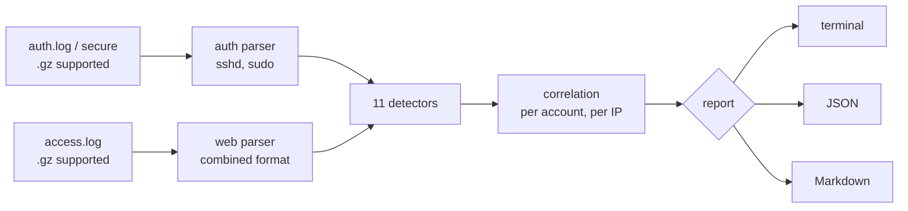

# LogSentry


LogSentry reads Linux auth logs and web server access logs, finds attacks in them, and tells you what happened in the order it happened. Every finding comes with the evidence lines, a MITRE ATT&CK technique, and a concrete response step.

It answers the questions a SOC analyst asks during triage:

- Is someone brute forcing SSH, or is it a user who mistyped a password twice?
- Did the brute force **work**? Did that account then become root?
- Which web requests were SQL injection, traversal, or web shell commands, and did the server answer them with 200 or 500?
- Which IPs should I look at first?

## Example

The repo ships with a day of synthetic logs ([`samples/`](samples)) in which three attackers are mixed into normal traffic. One command:

```console
$ logsentry scan --auth samples/auth.log --web samples/access.log --year 2026
```

finds all three and ranks them:

```text
Source IPs ranked by risk
  203.0.113.45       score  31   Reconnaissance > Initial Access > Persistence   [WEB-001 ... WEB-007]
  198.51.100.23      score  25   Credential Access > Initial Access > Privilege Escalation   [AUTH-004, SSH-001, SSH-003]
  192.0.2.77         score   5   Credential Access   [SSH-002]
  local:web01        score   2   Privilege Escalation   [AUTH-004]
```

Each finding looks like this:

```text
 CRITICAL  AUTH-004  Interactive root shell via sudo
  Source IP   198.51.100.23
  When        2026-10-24 03:38:36Z
  MITRE       T1548.003 Abuse Elevation Control Mechanism: Sudo and Sudo Caching (Privilege Escalation)
  Detail      'deploy' opened a root shell (/bin/bash) on web01, 2m 13s after a brute-forced login from 198.51.100.23.
  Respond     Confirm the user had a reason to open a root shell. Restrict sudoers to specific commands ...
  Evidence
    auth.log:87  Oct 24 03:36:23 web01 sshd[6690]: Accepted password for deploy from 198.51.100.23 port 46077 ssh2
    auth.log:89  Oct 24 03:38:36 web01 sudo:    deploy : TTY=pts/0 ; PWD=/home/deploy ; USER=root ; COMMAND=/bin/bash
```

The full Markdown incident report generated from the samples is in [`docs/sample-report.md`](docs/sample-report.md).

### The scenario in the sample logs

| Time (UTC) | Source | What the attacker does | Caught by |
|---|---|---|---|
| 02:10 | 203.0.113.45 | Runs Nikto, finds an exposed `/.env` | WEB-005, WEB-006, WEB-004 |
| 02:25 | 203.0.113.45 | Runs sqlmap against `/products.php`, gets 500 errors | WEB-001 |
| 02:40 | 203.0.113.45 | XSS probes on `/search`, reads `/etc/passwd` via `/download.php` | WEB-002, WEB-003 |
| 03:05 | 203.0.113.45 | Uploads `avatar.php`, runs `id`, `whoami`, `cat /etc/passwd` through it | WEB-007 |
| 03:30 | 198.51.100.23 | 64 SSH password guesses, gets in as `deploy`, runs `sudo /bin/bash` | SSH-001, SSH-003, AUTH-004 |
| 04:00 | 192.0.2.77 | Slow password spray: 12 usernames, under the brute force rate | SSH-002 |

The background traffic (2,400 normal page views, staff logins with occasional typos, cron, routine sudo) produces **no** findings, and a test enforces that. The one legitimate `sudo /bin/bash` by an admin is reported as MEDIUM, not CRITICAL, because no compromise preceded it. All IPs come from the [RFC 5737](https://www.rfc-editor.org/rfc/rfc5737) documentation ranges.

## Detection rules

| ID | Detects | Severity | MITRE ATT&CK |
|---|---|---|---|
| SSH-001 | 10+ failed SSH logins from one IP within 5 minutes (sliding window) | High | [T1110.001](https://attack.mitre.org/techniques/T1110/001/) Password Guessing |
| SSH-002 | One IP failing against 5+ distinct usernames | High | [T1110.003](https://attack.mitre.org/techniques/T1110/003/) Password Spraying |
| SSH-003 | Successful login from an IP that already failed 10+ times | Critical | [T1078](https://attack.mitre.org/techniques/T1078/) Valid Accounts |
| AUTH-004 | `sudo` to a root shell; Critical when it follows SSH-003 for the same account | Medium / Critical | [T1548.003](https://attack.mitre.org/techniques/T1548/003/) Sudo and Sudo Caching |
| WEB-001 | SQL injection: `UNION SELECT`, `' OR '1'='1`, `SLEEP()`, `information_schema` ... | Medium, High on 5xx | [T1190](https://attack.mitre.org/techniques/T1190/) Exploit Public-Facing Application |
| WEB-002 | Cross-site scripting: `<script>`, `onerror=`, `javascript:` | Medium | [T1190](https://attack.mitre.org/techniques/T1190/) |
| WEB-003 | Path traversal and LFI: `../`, `/etc/passwd`, `php://filter` | Medium, High on 200 | [T1190](https://attack.mitre.org/techniques/T1190/) |
| WEB-004 | Probing for `.env`, `.git/`, backups, `phpinfo.php` | Low, High on 200 | [T1595.003](https://attack.mitre.org/techniques/T1595/003/) Wordlist Scanning |
| WEB-005 | Attack tool user agents: sqlmap, Nikto, Nuclei, gobuster, WPScan ... | Medium | [T1595.002](https://attack.mitre.org/techniques/T1595/002/) Vulnerability Scanning |
| WEB-006 | 20+ 404 responses to one IP within 60 seconds | Medium | [T1595.003](https://attack.mitre.org/techniques/T1595/003/) Wordlist Scanning |
| WEB-007 | Requests like `shell.php?cmd=...`; Critical when the server answered 2xx | Medium / Critical | [T1505.003](https://attack.mitre.org/techniques/T1505/003/) Web Shell |

Run `logsentry rules` to print this list.

## How it works



Design decisions worth calling out:

- **Severity depends on the outcome, not only the attempt.** A probe for `/.env` answered with 404 is noise (Low). The same probe answered with 200 means secrets leaked (High). A SQL injection that triggers a 500 error probably reached the database. Analysts drown in alerts; ranking by outcome is what makes the output usable.
- **Sliding time windows, not totals.** Brute force is "10 failures within 5 minutes", computed with a two-pointer sweep over sorted timestamps. That separates a user with typos across a day from an attack, and the spray detector (distinct usernames) catches attackers who slow down to stay under the rate.
- **Correlation across events.** SSH-003 and AUTH-004 chain together: failed logins, then a success from the same IP, then a root shell by that account on that host. The root shell finding is attributed back to the attacker's IP so the risk ranking shows the whole intrusion as one story.
- **Payloads are URL-decoded twice** before matching, because double encoding (`%252e%252e%252f`) is a standard way to slip past filters that decode once.
- **All timestamps are normalized to UTC.** Web logs carry an offset; RFC 3339 syslog is converted; classic syslog has no year or zone, so it takes `--year` and is treated as UTC.
- **No dependencies.** Standard library only, so it runs on a locked-down server with nothing but Python.

## Usage

```console
$ pip install .                  # or: pip install -e ".[dev]" for development

$ logsentry scan --auth /var/log/auth.log --web /var/log/nginx/access.log
$ logsentry scan --auth auth.log.1.gz --auth auth.log --format json -o findings.json
$ logsentry scan --web access.log --format markdown -o incident.md --min-severity high
$ logsentry scan --auth auth.log --fail-on high   # exit code 2 if anything high or critical: use in cron or CI
$ logsentry rules
```

Thresholds are tunable: `--bruteforce-threshold`, `--bruteforce-window`, `--spray-users`, `--enum-threshold`. Run `logsentry scan -h` for the full list.

Without installing: `PYTHONPATH=src python -m logsentry scan ...`

To regenerate the sample logs: `python scripts/generate_samples.py samples`

## Tests

```console
$ pip install -e ".[dev]"
$ pytest
```

63 tests cover the parsers (syslog and RFC 3339 timestamps, IPv6, malformed request lines, time zone conversion), every detector, the cases that must **not** alert (typos, slow failures, normal URLs that contain words like `select` or `union`, `?c=home` routing parameters), and the CLI end to end. GitHub Actions runs them on Python 3.10 to 3.13.

## Limitations

Being honest about what this is not:

- Signature matching on URLs can be evaded (unusual encodings, payloads in POST bodies, which access logs do not record). This is a triage tool, not a replacement for a WAF or EDR.
- It analyzes files after the fact; it does not tail logs in real time.
- The web shell rule looks for command-style parameters (`cmd=`, `exec=`), so a web shell with custom parameter names will be missed unless another rule fires.
- Auth logs from systemd-journald need exporting first: `journalctl -u ssh -o short > auth.log`.

## Roadmap

- [ ] Real-time mode (`--follow`) that tails logs and alerts as events arrive
- [ ] Rules loaded from YAML so new detections need no code changes, with a Sigma rule importer
- [ ] GeoIP and threat intelligence enrichment (AbuseIPDB) for source IPs
- [ ] Windows Security event log parser (4625 failed logon, 4672 special privileges)
- [ ] Output in a format a SIEM can ingest (ECS JSON for Elastic)

## Project layout

```text
src/logsentry/
  parsers.py     auth.log and access.log parsing, UTC normalization, gzip
  detectors.py   the 11 detection rules and correlation logic
  rules.py       rule catalog: titles, MITRE mapping, response guidance
  report.py      terminal, JSON and Markdown output, per-IP risk ranking
  cli.py         command line interface
scripts/generate_samples.py   builds the synthetic attack scenario
samples/                      generated logs used by the tests and the demo
tests/                        pytest suite
```

## License

MIT, see [LICENSE](LICENSE).
